 
 

  <b>⚡ Curated directory of leading SaaS platforms and open-source projects for real-time endpoint querying, live threat hunting, osquery fleet orchestration, and distributed digital forensics (DFIR). 🔍</b>

---

## 📑 Table of Contents

- [📊 Sector Overview & Market Dynamics](#-sector-overview--market-dynamics)
- [☁️ SaaS/Hosted Platforms](#️-saashosted-platforms)
- [🔓 Open-Source GitHub Projects](#-open-source-github-projects)
- [🏗️ Key Architectural Considerations](#️-key-architectural-considerations)
- [🤝 How to Contribute](#-how-to-contribute)
- [💖 Support](#-support)
- [📈 Star History](#--star-history)
- [⚠️ Disclaimer](#️-disclaimer)

---

## 📊 Sector Overview & Market Dynamics

The global **Endpoint Detection and Response (EDR) and Endpoint Query Investigation market** is valued at approximately **$5.0B – $5.7B in 2025** and is projected to expand to **$6.3B – $7.2B by 2026**, growing at a rapid CAGR of ~22–25%. The broader **Endpoint Security Platform (EPP/EDR/XDR)** market is estimated between **$17B and $22B**.

Market concentration & competitive dynamics:
- 🏢 **Enterprise Platform Tier (Moderately Concentrated)**: Monopolized by large-cap security juggernauts (Microsoft, CrowdStrike, SentinelOne, Broadcom) offering integrated suites where live query capabilities sit on top of massive proprietary continuous kernel telemetry streams.
- 🧩 **Specialized Fleet & Query Tier (Fragmented & Open)**: Active innovation exists across independent fleet managers and open instrumentation tools (Tanium, FleetDM, Kolide, Uptycs), heavily anchored by the open-source **osquery** SQL schema standard.

---

## ☁️ SaaS/Hosted Platforms

The following hosted commercial platforms provide fleet-scale live query interrogation, threat hunting, and distributed incident investigation. Ranked descending by company scale (market capitalization / valuation):

| Platform | Company Size (Market Cap / Valuation) 🏛️ | Starting Tier Pricing 💵 | Free Tier / Free Trial Limits ⏱️ | Key Features & Investigation Capabilities 🛡️ |
| :--- | :--- | :--- | :--- | :--- |
| **[Microsoft Defender Advanced Hunting](https://learn.microsoft.com/en-us/microsoft-365/security/defender-endpoint/)** | ~$3.1 Trillion *(Public: MSFT)* | **$5.20 / user / month** (Defender for Endpoint Plan 2 standalone; covers up to 5 devices/user) | **90-day free trial** with full enterprise evaluation capabilities (or 30 days via direct Azure tenant portal) | ⚡ Query-based live threat hunting using Kusto Query Language (KQL) across up to 30 days of raw endpoint telemetry. Includes automated investigation & response (AIR). |
| **[Carbon Black Live Query](https://www.broadcom.com/products/security/endpoint-security)** | ~$820 Billion *(Broadcom: AVGO)* | **~$50.00 – $70.00 / endpoint / year** (Carbon Black Cloud Advanced tier) | **30-day free evaluation** (extends to 90 days for specific qualified enterprise POCs) | 🎯 Cloud-managed osquery integration inside NGAV/EDR; features visual Query Builder across 10 core tables and raw SQL query execution across OS tables. |
| **[CrowdStrike Falcon Live Query](https://www.crowdstrike.com/)** | ~$85 Billion *(Public: CRWD)* | **$184.99 / endpoint / year** (Included in Falcon Enterprise tier with Falcon Insight XDR) | **15-day free trial** (Full sandbox trial of Falcon Enterprise platform) | 🦅 Distributed on-demand SQL queries against active online hosts via single lightweight Falcon sensor; queries processes, network connections, memory, and hashes with Charlotte AI assistance. |
| **[Tanium Interact](https://www.tanium.com/)** | ~$9 Billion *(Private valuation; >$700M ARR)* | **$20.00 – $24.00 / endpoint / year** (Core Platform; scales down to $8–$10 for 50k+ fleets; 2,000 endpoint min commitment) | **30-day guided Proof of Concept (POC)** / evaluation tenant via sales | 🔄 Proprietary linear-chain architecture enabling natural language and scripted interrogation across hundreds of thousands of endpoints in seconds without pre-indexing data. |
| **[SentinelOne Deep Visibility](https://www.sentinelone.com/)** | ~$8 Billion *(Public: S)* | **$179.99 / endpoint / year** (~$15.00/endpoint/month for Singularity Complete tier) | **30-day full-access free trial** / Singularity platform evaluation | 🔍 Patented Storyline kernel monitoring enabling sub-second live IOC query and retrospective search; uniquely supports forensic queries on offline endpoints via retained historical telemetry. |
| **[Sophos Live Discover](https://www.sophos.com/)** | ~$3.9 Billion *(Thoma Bravo acquisition)* | **$108.00 – $115.00 / user / year** (Intercept X Advanced with XDR) | **30-day full-featured free trial** across Sophos Central and endpoint agents | 🛡️ osquery-powered SQL hunting engine embedded into Sophos Central Data Lake; pre-built templates for incident response, threat hunting, and compliance auditing. |
| **[Kolide (by 1Password)](https://www.kolide.com/)** | ~$2 Billion *(1Password valuation)* | **$6.00 / device / month** (Historically $6.00–$7.20/device/month; now part of 1Password Extended Access Management) | **14-day free trial** with full feature access and Slack/IdP integration | 💬 Cloud-native osquery fleet manager featuring Slack and Identity Provider (IdP) integration; user-focused device trust verification and continuous configuration checks. |
| **[Uptycs](https://www.uptycs.com/)** | ~$600 Million *(Series C valuation)* | **$2.00 / endpoint / month** (Core osquery fleet management; Flight Recorder telemetry add-on ~$1.00/endpoint/month) | **35-day free trial** (Starts with pre-seeded synthetic data before live agent testing) | 📦 Unified CNAPP, XDR, and compliance platform built atop an enterprise osquery distribution; streaming telemetry into a centralized SQL database for continuous auditing. |

---

## 🔓 Open-Source GitHub Projects

The open-source endpoint query landscape is anchored by **osquery** and high-speed DFIR incident response agents. Sorted descending by GitHub stargazers count:

| Repository 📦 | GitHub Stars ⭐ | Primary Purpose & Description 🚀 |
| :--- | :--- | :--- |
| **[osquery/osquery](https://github.com/osquery/osquery)** |  | ⚡ Foundational open-source endpoint instrumentation agent (Apache 2.0 / GPL 2.0). Exposes operating system internals (processes, open sockets, installed software, logged-in users) as high-performance SQL tables. |
| **[wazuh/wazuh](https://github.com/wazuh/wazuh)** |  | 🛡️ Unified open-source XDR, SIEM, and endpoint security monitoring platform (GPL 2.0). Features built-in osquery integration, live command execution, file integrity monitoring (FIM), and incident response rules. |
| **[fleetdm/fleet](https://github.com/fleetdm/fleet)** |  | 🌐 Premier open-source osquery fleet manager and MDM platform (MIT / Core). Provides web UI, CLI (`fleetctl`), TLS enrollment, automated query packs, and compliance policy reporting across large fleets. |
| **[google/grr](https://github.com/google/grr)** |  | 🔬 GRR Rapid Response (Apache 2.0). Scalable enterprise incident response and live digital forensics framework built by Google for remote collection of memory, disk artifacts, and distributed live interrogation. |
| **[Velocidex/velociraptor](https://github.com/Velocidex/velociraptor)** |  | 🦖 Advanced digital forensics and incident response (DFIR) platform (AGPL 3.0). Uses Velociraptor Query Language (VQL) to provide live endpoint hunting, artifact acquisition, and distributed interrogation. |
| **[kolide/fleet](https://github.com/kolide/fleet)** |  | 🏛️ Legacy Go-based osquery fleet management server (MIT). Historical predecessor to FleetDM; maintained as a reference archive. |
| **[palantir/osquery-configuration](https://github.com/palantir/osquery-configuration)** |  | 📋 Production-tested osquery deployment configurations, scheduled query packs, and incident response detection baselines open-sourced by Palantir's InfoSec team (Apache 2.0). |
| **[osquery/osquery-go](https://github.com/osquery/osquery-go)** |  | 💻 Official Go client bindings and SDK (Apache 2.0) for writing native osquery extensions, custom plugins, tables, and config plugins. |
| **[trailofbits/osquery-extensions](https://github.com/trailofbits/osquery-extensions)** |  | 🧩 Production-ready osquery extensions developed by Trail of Bits (Apache 2.0), introducing advanced table providers for forensic artifact extraction and system integrity checks. |
| **[Kirtar22/ThreatHunting_with_Osquery](https://github.com/Kirtar22/ThreatHunting_with_Osquery)** |  | 🎯 Comprehensive repository containing 100+ production-ready threat hunting SQL queries mapped directly to the MITRE ATT&CK framework across Windows and Linux environments. |

---

## 🏗️ Key Architectural Considerations

1. ⏱️ **On-Demand Interrogation vs. Continuous Telemetry (EDR)**:
   - **osquery** is explicitly designed for *periodic and on-demand queries*. Its maintainers note that it is not an event-driven kernel EDR replacement.
   - Commercial platforms (CrowdStrike, SentinelOne, Microsoft Defender) maintain persistent kernel ring sensors logging continuous process trees and network flows, supporting both historical replay and live ad-hoc interrogation.
2. 🔌 **Offline vs. Online Host Reachability**:
   - Solutions like CrowdStrike Live Query and basic osquery setups can only interrogate machines that are currently active and connected to the network.
   - Platforms like SentinelOne Deep Visibility and Microsoft Defender buffer historical sensor states in cloud telemetry lakes, facilitating retrospective hunts on disconnected or decommissioned machines.
3. 🎛️ **Fleet Management Layer**:
   - osquery is purely an endpoint agent. Operational enterprise deployment requires pairing it with a robust control plane (such as **FleetDM**) or integrating it into a comprehensive open-source XDR pipeline like **Wazuh**.

---

## 🤝 How to Contribute

Contributions are always welcome! 🌟
1. 🍴 Fork this repository.
2. ✍️ Add or edit entries in `README.md` following the established table formats.
3. 🔍 Ensure pricing, valuation metrics, and star counts are verifiable with authoritative sources.
4. 🚀 Submit a Pull Request with a clear description of your additions.

---

## 💖 Support

Thank you for visiting and supporting this project! If you found this curated ecosystem helpful:
- ⭐ **Star this repository** to help others discover it.
- 🍴 **Fork it** and build your own custom endpoint hunting stacks.
- 📢 **Share it** with fellow threat hunters, SOC analysts, and security engineers.
- ☕ If you'd like to support the ongoing maintenance and research behind this project, consider buying a coffee via the [GitHub Sponsor Dashboard](https://github.com/sponsors/ishandutta2007)! Every contribution is greatly appreciated.

---

## 📈 Star History

---

## ⚠️ Disclaimer

- 🛡️ This list is community-curated for informational, educational, and architectural evaluation purposes.
- 🔑 System interrogation tools require privileged system-level permissions. Ensure proper authorization, access controls, and data privacy safeguards before executing distributed queries across production fleets.
- 📊 Product pricing and corporate valuations reflect market conditions and vendor tier structures as of early 2026; consult vendors directly for official contractual quotes.
